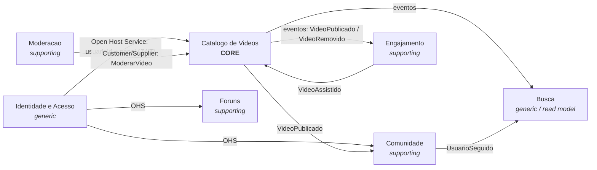

# Mapa de Contextos (Context Map)

| Relacao | Padrao DDD | Como se comunica |
| --- | --- | --- |
| Identidade -> demais | Open Host Service + Published Language | Token JWT com `id`, `username`, `papel` |
| Catalogo -> Engajamento, Busca, Comunidade | Publisher/Subscriber | Eventos de dominio via broker (Questao 2) |
| Moderacao -> Catalogo | Customer/Supplier | Caso de uso `ModerarVideo` exposto pelo Catalogo |
| Engajamento -> Catalogo | Eventos | `VideoAssistido` atualiza `viewsCount` de forma assincrona |
